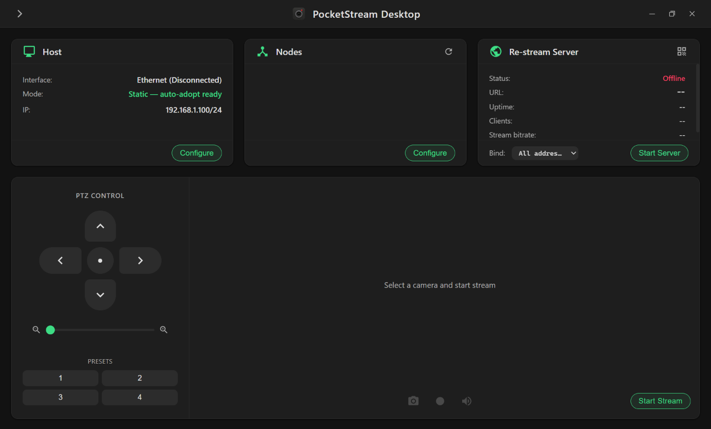
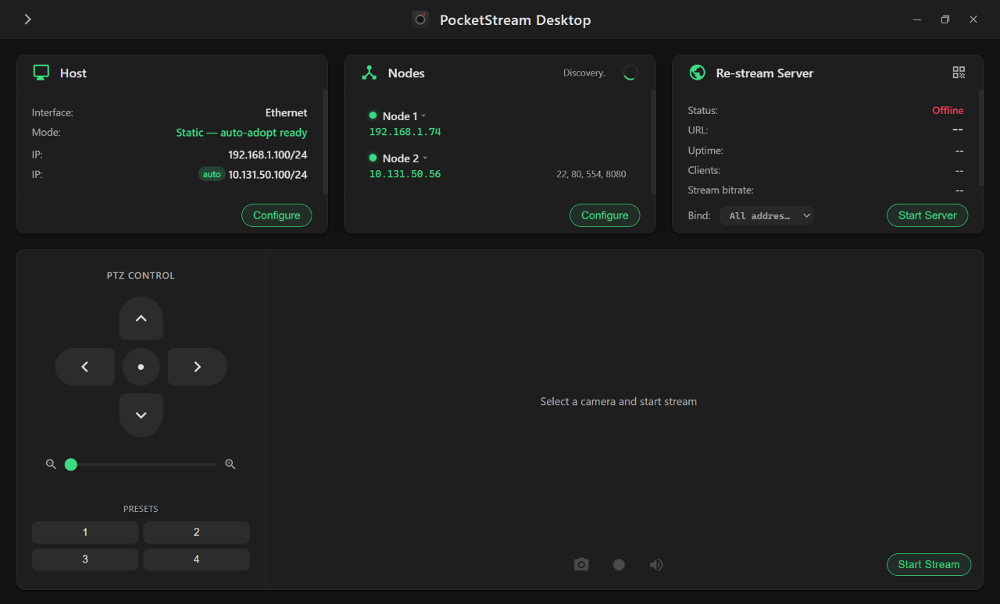
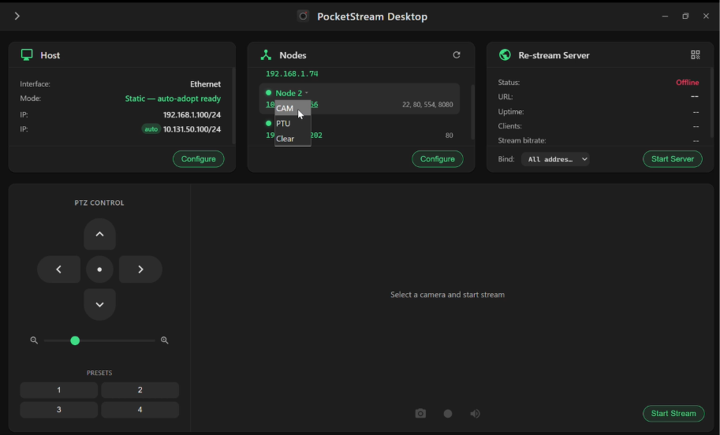
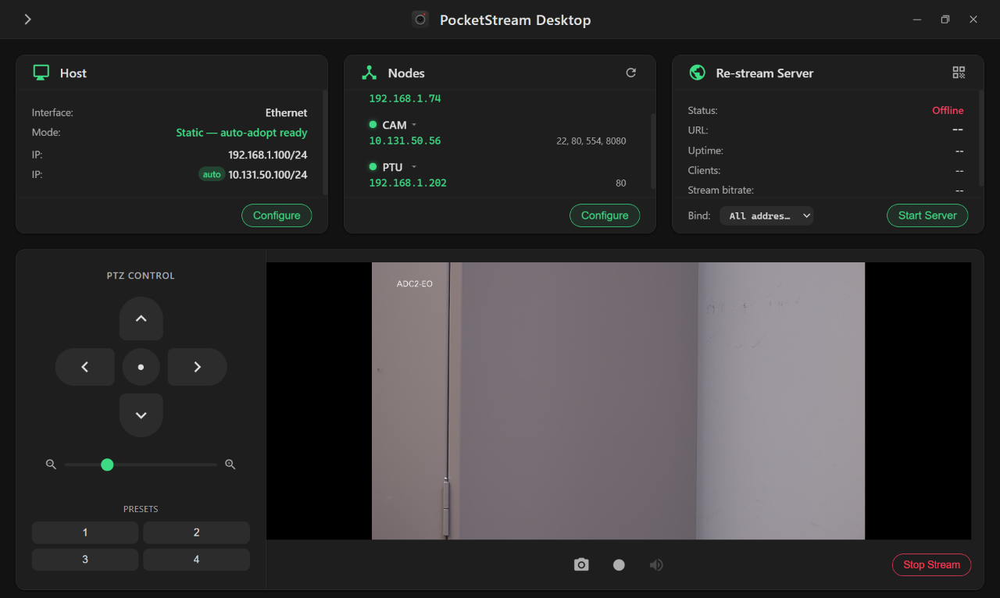
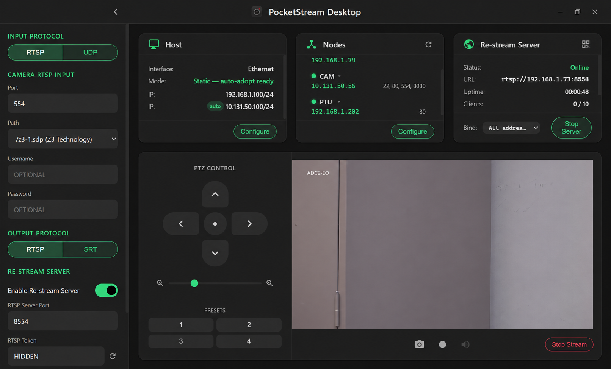
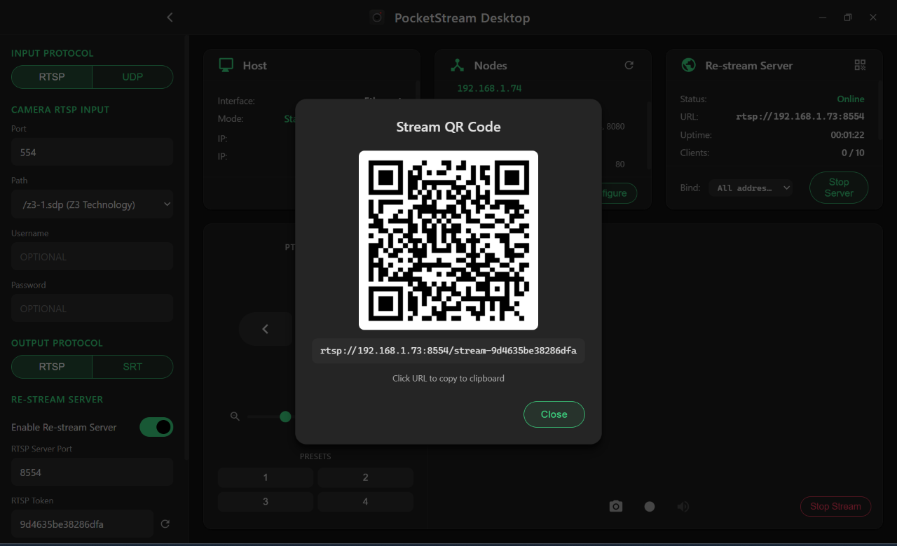

# PocketStream Desktop

Turn a Windows laptop into a portable IP-camera monitoring and relay station. Discover cameras over Ethernet, view and record their video, share feeds over RTSP or SRT, and control FLIR pan-tilt units.

Based on [PocketStream for Android](https://github.com/RustRunner/PocketStream).

[Download](https://github.com/RustRunner/PocketStream-Desktop/releases) · [Workflow](#workflow) · [Development](docs/DEVELOPMENT.md)

## Features

- **Automatic discovery:** Find cameras on the selected Ethernet adapter, including cameras that retain an old DHCP address on another subnet.
- **Playback and capture:** Watch RTSP or UDP video, play G.711 audio, save snapshots, and record MP4s.
- **Stream sharing:** Share token-protected RTSP feeds, or use SRT with optional passphrase encryption. Connect viewers by URL or QR code.
- **FLIR control:** Move a pan-tilt unit with hold-to-move controls, return it home, and save four position presets.
- **Network management:** Configure Ethernet addresses, inspect device ports, and select Ethernet, Wi-Fi, or VPN interfaces for re-streaming.

| Direction | Supported protocols |
| --- | --- |
| Camera → PocketStream | RTSP or UDP |
| PocketStream → viewers | RTSP or SRT (listener mode, up to 10 callers) |

Input and output protocols are selected independently. SRT input is not supported.

## Installation

You need:

- Windows 11 and administrator access.
- An Ethernet connection to the camera.
- A camera with a static IP address or a retained DHCP address. Cameras using APIPA (`169.254.x.x`) must first be given a usable address with the vendor's tools.

Download and run the Windows installer from [Releases](https://github.com/RustRunner/PocketStream-Desktop/releases). GStreamer is bundled, and discovery uses Windows' built-in PacketMonitor API; no separate capture driver is required.

The app checks GitHub releases for updates and offers **Install** or **Later** when one is available.

## Workflow

### 1. Connect and discover

1. Open PocketStream **before connecting the camera's Ethernet cable**.
2. Under **Host → Configure**, select the Ethernet adapter and use **Static — Auto-adopt** for automated discovery, or **Static — Manual** for manually configured IPs with discovery disabled.
3. In **Auto-adopt** mode, let discovery start listening, then connect the camera. Find it in **Nodes** and assign it the **CAM** role. If you have a FLIR pan-tilt unit, assign it **PTU**. One device can hold each role at a time.

Launching first helps discovery capture the camera's initial **gratuitous ARP** announcements. If a camera does not appear, reconnect its network cable while discovery is running.

Once scanning finishes, use the open ports listed beside each IP to identify likely roles:

| Ports listed | What they suggest |
| --- | --- |
| **554** (possibly alongside other ports) | The standard RTSP video port; usually the camera to assign as **CAM**. |
| **80 only** | A web interface; a likely **PTU** candidate in a FLIR camera/PTU setup. Open its web page to confirm, since other devices can also use port 80. |
| **No ports listed** | No services responded on the scanned ports. Ignore this entry when choosing **CAM** or **PTU**. |

Before connecting a camera

*Discovery finds devices and adds a host address for the camera's subnet.*

Assigning CAM and PTU roles

### 2. View, record, and control

Open settings and choose **Input Protocol**:

- **RTSP:** Set **Port** (typically 554) and choose a matching stream path from **Path**. Common camera paths are already listed; for another path, select **Custom…** and enter it in **Custom Path**. Enter the camera's **Username** and **Password** if required; otherwise leave them blank.
- **UDP:** Set the listening port and configure the camera to send video to the PC on that port.

Click **Save Settings**, then **Start Stream**. Use the video controls to mute audio, record an MP4, or save a snapshot to Pictures.

With a **PTU** assigned, hold the directional controls to move it. Tap a preset to recall a position; long-press to save one.

*The live view keeps video, capture controls, and pan-tilt controls together.*

### 3. Share the feed

1. In settings, turn on **Enable Re-stream Server**, choose **Output Protocol**, configure the server settings, and click **Save Settings**.
2. In the **Re-stream Server** card, choose the **Bind** interface and click **Start Server**.
3. Connect viewers using the copied connection URL or QR code.

**Bind** defaults to **All addresses**, so the server listens on all local IPv4 addresses. The displayed URL and QR code use an active LAN address, preferring Wi-Fi and then Ethernet. If a VPN is configured and connected, select its interface in **Bind** to listen specifically on its VPN IP address and use that address in the URL and QR code.

**UDP input:** Current builds prevent PocketStream's video display and re-stream server from receiving on the same UDP port. Click **Stop Stream**, then **Start Server**. The camera keeps sending video, and the re-stream server still supports multiple viewers.

*Choose the input and output protocols in settings, then start the server.*

*Share the stream by scanning the QR code or copying the connection URL.*

#### RTSP access

The **RTSP Token** is part of the full re-stream URL and QR code. Viewers use that complete link; no separate re-stream username or password is needed. The token is separate from the camera's RTSP login and does not encrypt the video.

To replace the token, use its regenerate button, click **Save Settings**, and share the new URL or QR code.

#### SRT encryption and Stream ID

PocketStream runs as an SRT **listener** for up to 10 **callers**. Configure each viewer as a caller.

- **SRT Passphrase (optional):** Enables encryption. Use 10–79 visible ASCII characters with no spaces, and enter the same passphrase in the viewer. SRT does not use a username. Without a passphrase, the stream is unencrypted.
- **Required Stream ID (optional):** When set, the viewer must send the same identifier. This is an SRT stream identifier, separate from the RTSP token and not a password.

The connection URL and QR code exclude the SRT passphrase. Use the passphrase field's copy button and share it separately.

## Network notes

- **Manage host IPs in the app.** Use **Host → Configure** to set the primary IP address, add or remove secondary addresses, and choose static or DHCP mode. Routine host network setup requires no manual changes in Windows network settings.
- **Added IP addresses persist.** Host addresses added for camera access remain after closing the app or restarting Windows. Remove them explicitly through **Host → Configure**; removing a Node does not remove its host address.
- **IP conflicts can block browser access.** If the app reports **IP still reserved by PC**, open Network Connections (`Win+R` → `ncpa.cpl`), fully disable the named conflicting adapter, give the camera an unused IP through its web page, then re-enable the adapter. Turning off Wi-Fi alone may leave the address reserved.

See the [release notes](RELEASE-NOTES.md) for detailed network behavior, downgrade limitations, and pending hardware qualification.

## Development

Built with Rust, Tauri 2, TypeScript, and GStreamer. See the [development guide](docs/DEVELOPMENT.md) for build prerequisites, tests, architecture, and discovery benchmarks.

## License

Licensed under the [GNU General Public License v3.0 only](https://www.gnu.org/licenses/gpl-3.0.html) (SPDX: `GPL-3.0-only`). See [LICENSE](LICENSE).

- The installer bundles GStreamer (LGPL-2.1+, plus the GPL-2.0+ x264 encoder) and supporting libraries. Notices and license texts are installed under `resources\licenses\` and available in **About → Licenses & Notices**.
- Corresponding source and build recipes are available in the [gst-src-1.26.11 release](https://github.com/RustRunner/PocketStream-Desktop/releases/tag/gst-src-1.26.11), with mirrors for each pinned GStreamer version.
- Rust dependency notices are generated at release time and installed as `resources\licenses\generated\THIRD-PARTY-RUST.md`.
